# 1. Main Frame

[📦 Download the printable model on MakerWorld](https://makerworld.com/en/models/3179915-boeing-737-overhead-frame)

[← Back to model list](README.md)

---

## Filament

| | Colour | Filament |
|---|---|---|
|  | Black | Bambu PLA Basic Black (10101) |
|  | White | Bambu PLA Basic Jade White (10100) |

I printed the frame parts in black and the angle wedges in white, but the colour does not really matter.

---

## 3D Printed Parts

| Qty | Part | Notes |
|---:|---|---|
| 25× | Frame part | |
| 2× | Light panel support | FWD section only |
| 2× | Angle wedge | |
| 15× | Frame spacing jig | temporary, used during assembly only |
| 2× | Angle alignment jig | temporary, used during assembly only |

---

## Plywood

The plastic frame sits on a frame made of **10 mm plywood**, cut into strips 60 mm wide. The quantities are for the whole frame, FWD and AFT sections together.

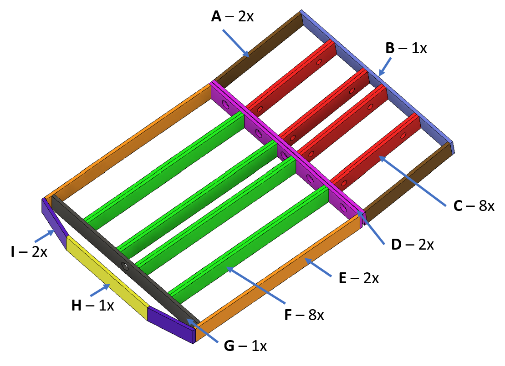

| Qty | Part | Size |
|---:|---|---|
| 2× | A | 330 × 60 × 10 mm |
| 1× | B | 656 × 60 × 10 mm |
| 8× | C | 330 × 60 × 10 mm |
| 2× | D | 656 × 60 × 10 mm |
| 2× | E | 634 × 60 × 10 mm |
| 8× | F | 605 × 60 × 10 mm |
| 1× | G | 636 × 60 × 10 mm |
| 1× | H | 352 × 60 × 10 mm |
| 2× | I | 160 × 60 × 10 mm |

The large holes in C, D and G are for cable routing only, so their size is not critical. The Ø 5 mm holes in G, H and I are for the screws that hold the [light panel supports](#4-light-panel-supports).

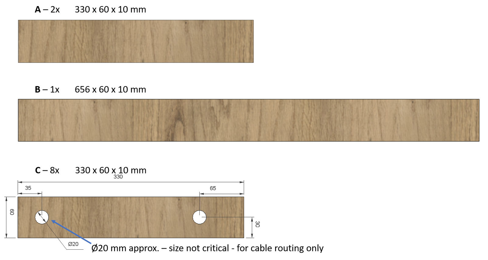

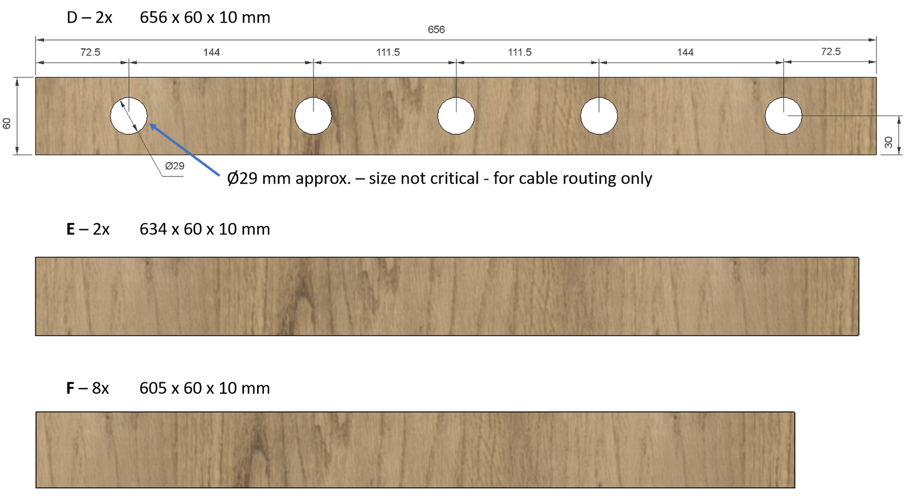

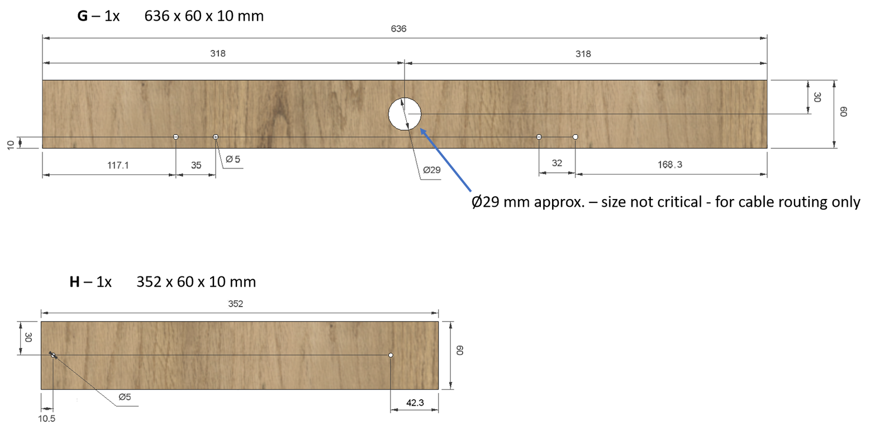

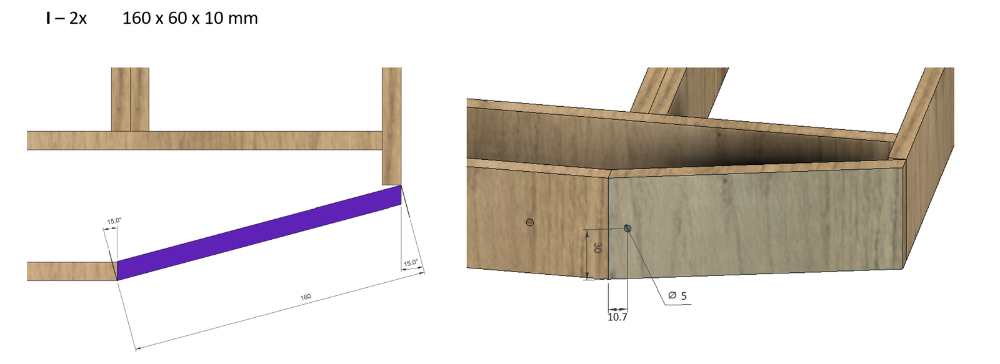

---

## Screws

| Qty | Screw | Joins | Reference |
|---:|---|---|---|
| 169× | Brass heat-set threaded insert M4, OD 5 mm, L 5 mm | pressed into the frame parts | [Product I used](../../images/parts/AE_insert_M4.png) |
| 185× | Wood screw 3 × 30 mm | frame part + plywood, plywood + plywood | |
| 1× | Flat head M4×16 | light panel support + frame | |
| 7× | Flat head M4×25 | light panel support + frame | |
| 4× | Dome head M4×25 | light panel support + frame, with an M4 lock nut | |
| 4× | Hex head M6×35 | FWD + angle wedge + AFT, with an M6 nut | |
| 4× | M4 lock nut | | |
| 4× | M6 nut | | |

---

## Assembly

The AFT and FWD sections are assembled separately and independently. They are connected to each other only at the final stage.

### 1. Threaded inserts

After printing all the parts, install the threaded inserts into the corresponding holes using the tip of a soldering iron.

The inserts go only into the 25 frame parts. Together they form the plastic frame, an intermediate layer between the plywood and the instrument panels. This layer and its threaded inserts let every panel be installed and removed again and again without damaging the frame.

> **⚠️ There are three types of holes in the frame**\
> The first type is for the threaded inserts. The second type is countersunk and is for the wood screws that hold the plastic frame to the plywood. The third type is in the **tabs** - the small lugs that stick out of the frame and are only half as high as the rest of it. These holes are slightly larger than the screw: a dome head M4×10 goes through them to hold the panels that are fitted from behind, such as the [PSEU Panel](15-pseu-panel.md), the [Landing Gear Indicator Panel](16-landing-gear-indicator-panel.md), the [Interphone and Dome Panel](27-interphone-and-dome-panel.md) and some of the blank panels. **Do not put inserts into them.** Before installing the inserts, turn each frame part so that you can see the countersunk holes - that means its top side is facing up.

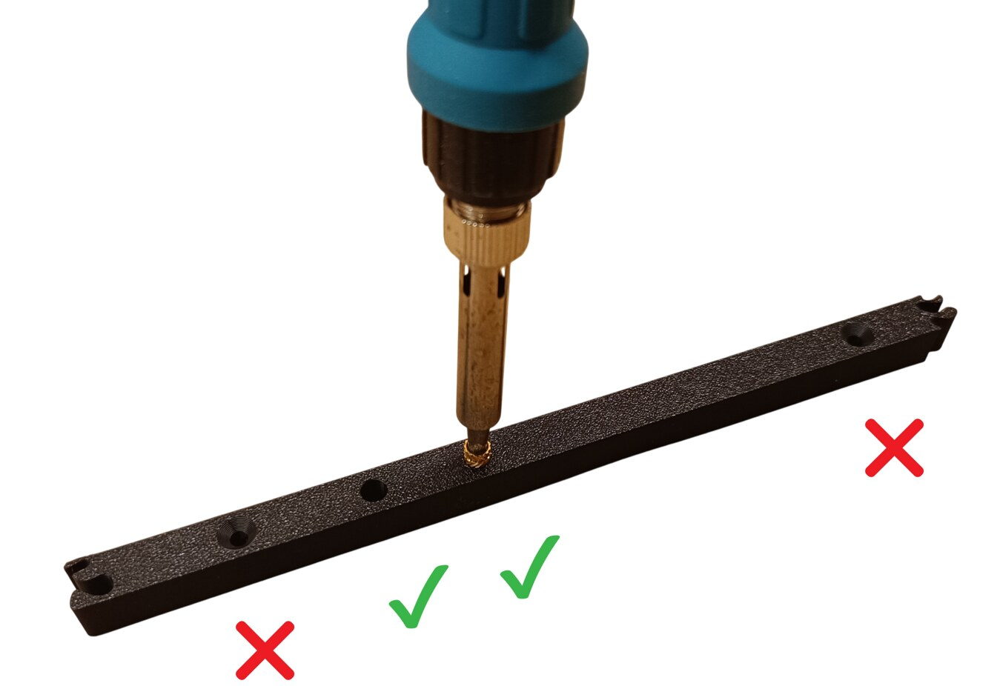

### 2. Frame sections

Assemble the FWD and AFT frame from the 25 printed frame parts. Every connection between two frame parts is unique, so each part fits only its own neighbour and the frame cannot be put together the wrong way.

Fit the temporary frame spacing jigs to keep the correct spacing between the frame parts during assembly. Hold them with dome head M4×10 screws.

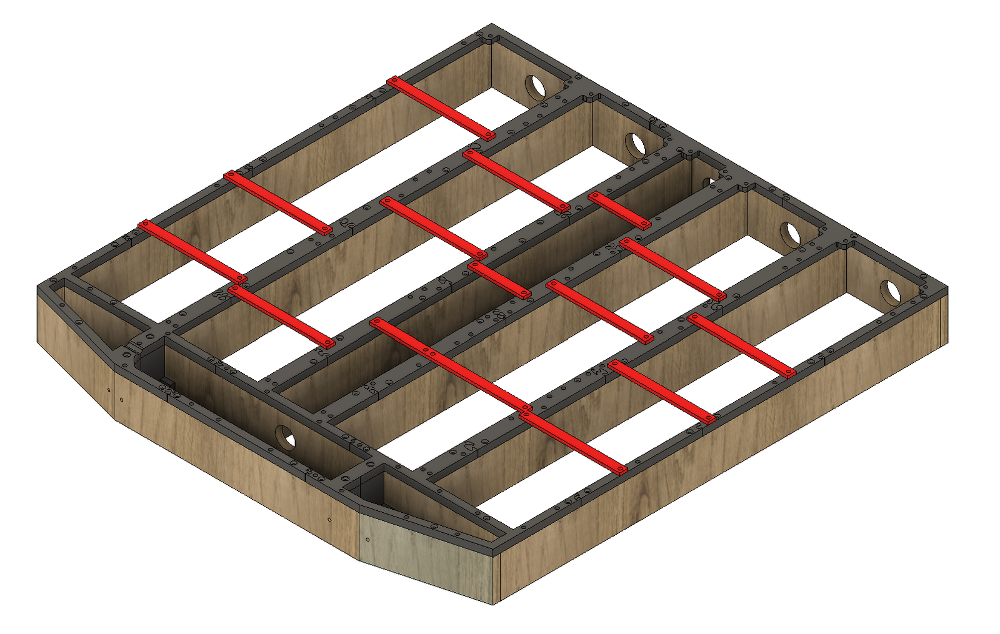

### 3. Plywood panels

Add the plywood panels. Align each one with its frame parts and screw the frame parts to the plywood.

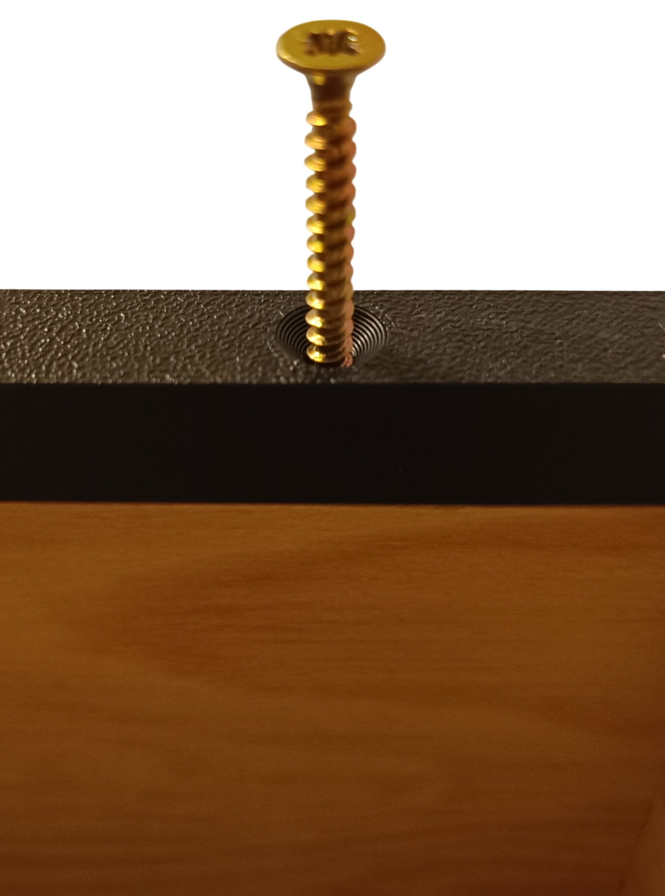

### 4. Light panel supports

On the FWD section, install both light panel supports as well. They keep the panel upright - without them, the lower part of the frame could not carry its full weight.

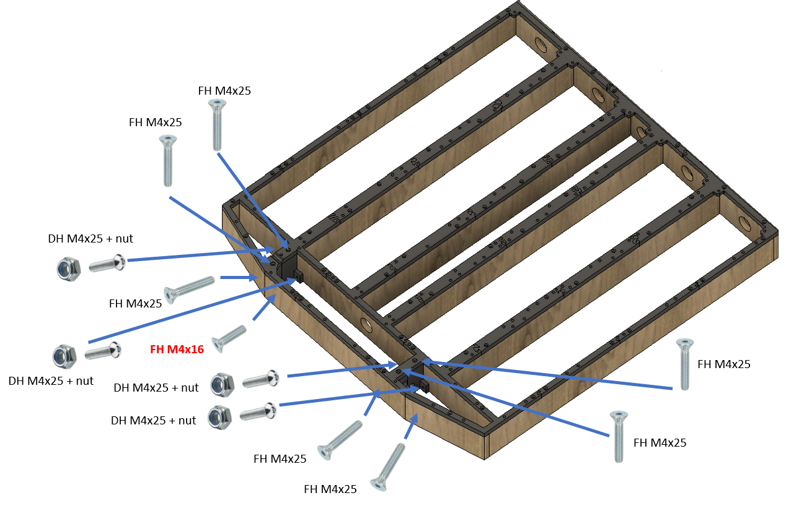

### 5. Securing the plywood panels

Once all frame parts are screwed to the plywood, screw the plywood panels to each other to complete each section.

<table>
<tbody>
<tr>
<td align="center" width="50%">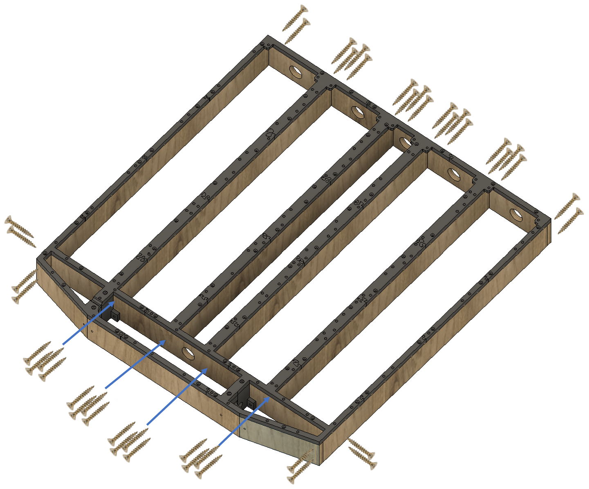 FWD section</td>
<td align="center" width="50%">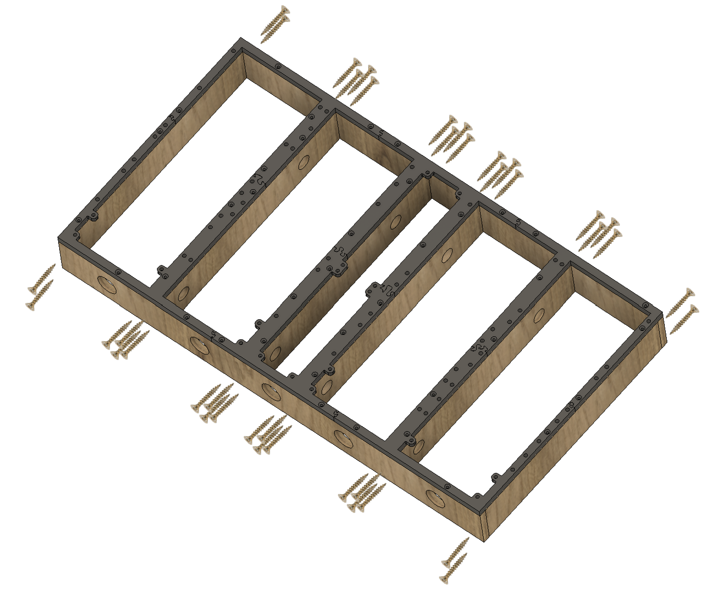 AFT section</td>
</tr>
</tbody>
</table>

### 6. Connecting the FWD and AFT sections

Once both sections are complete, screw them together temporarily with the angle alignment jigs, as shown below.

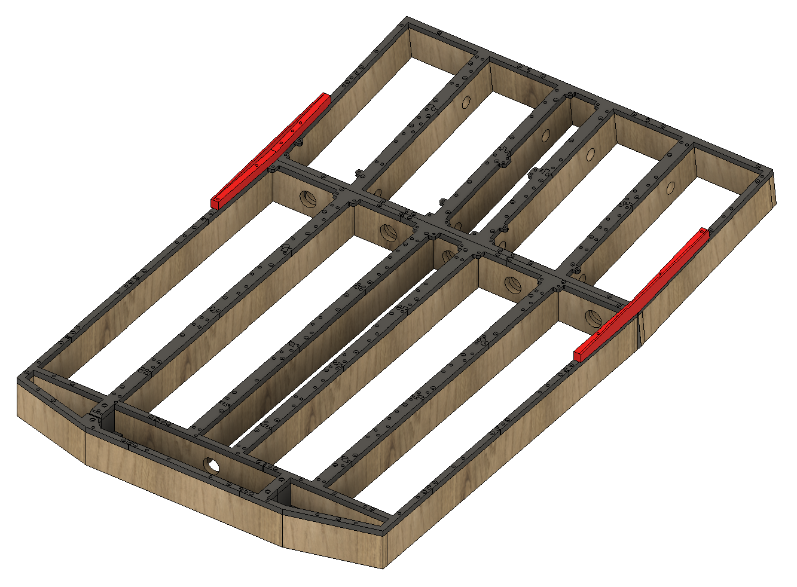

Then insert the two angle wedges between the sections. Drill through both frames and the wedges, and bolt the sections together with the M6×35 hex screws and M6 nuts.

<table>
<tbody>
<tr>
<td align="center" width="50%">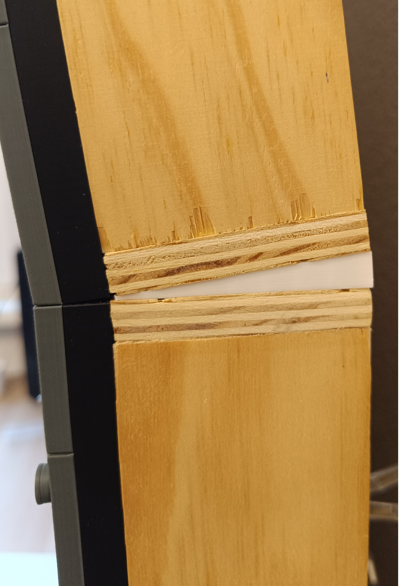 The angle wedge between the two sections</td>
<td align="center" width="50%">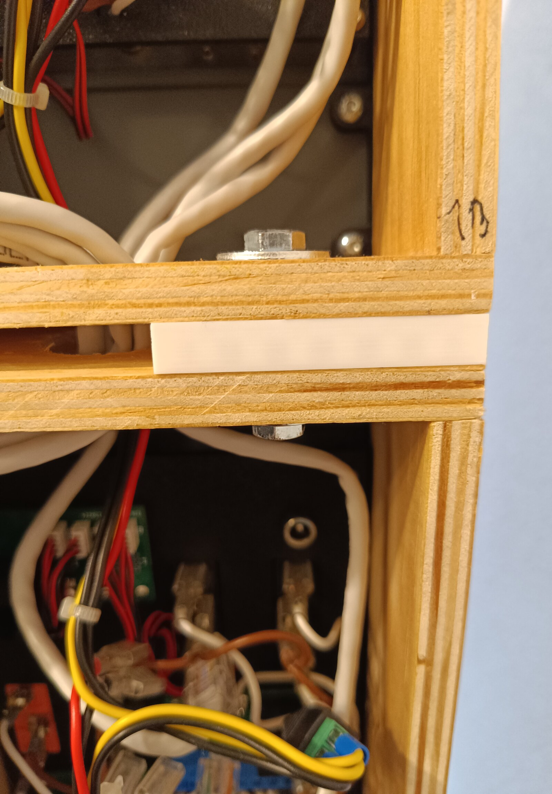 The M6 hex screw through both sections and the wedge</td>
</tr>
</tbody>
</table>
