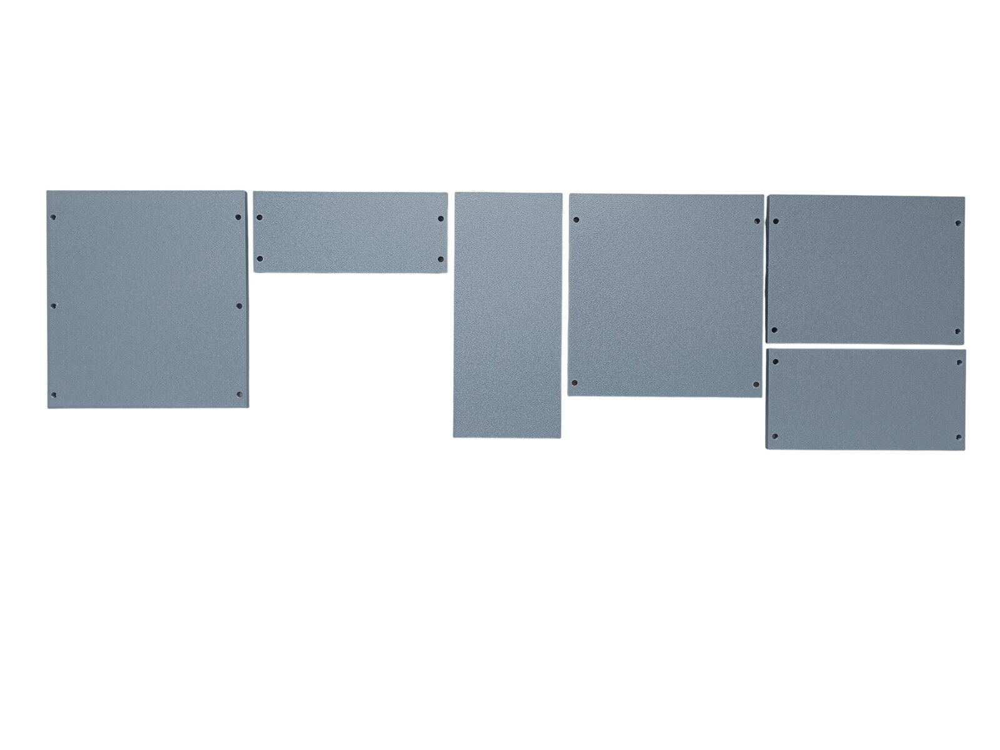
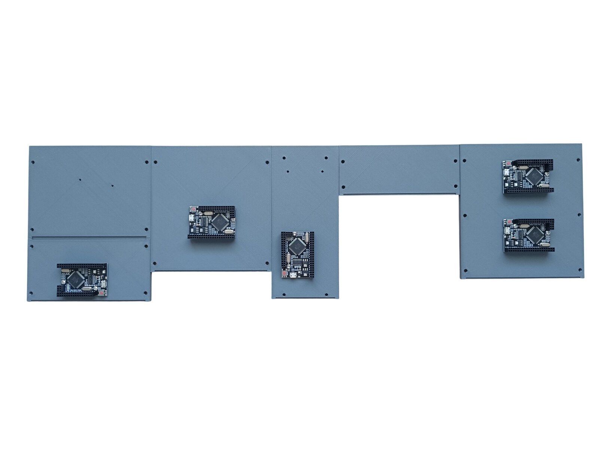
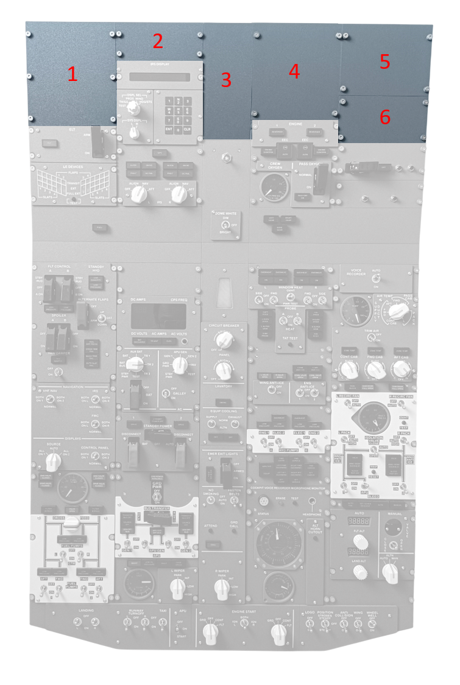
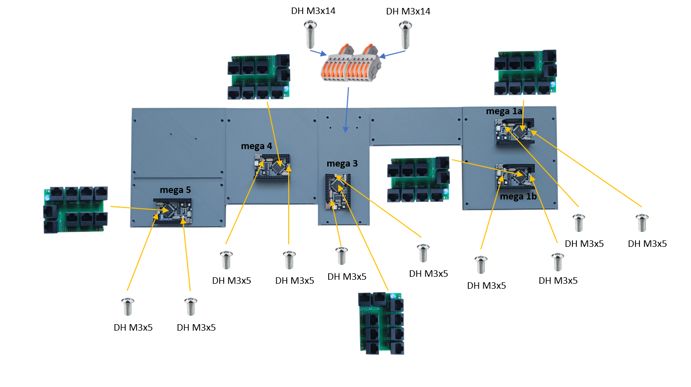
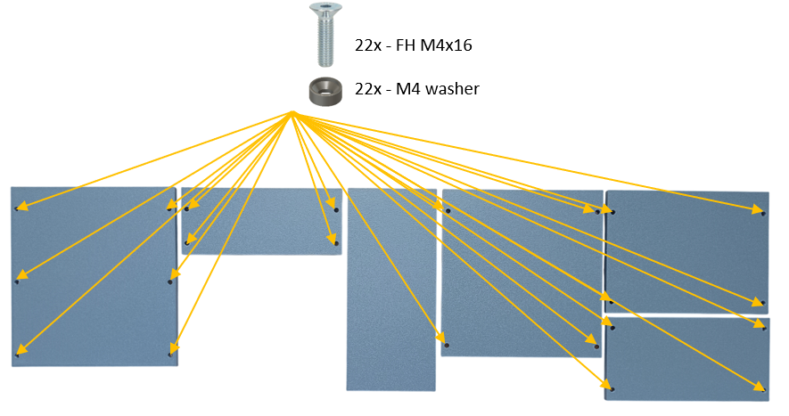
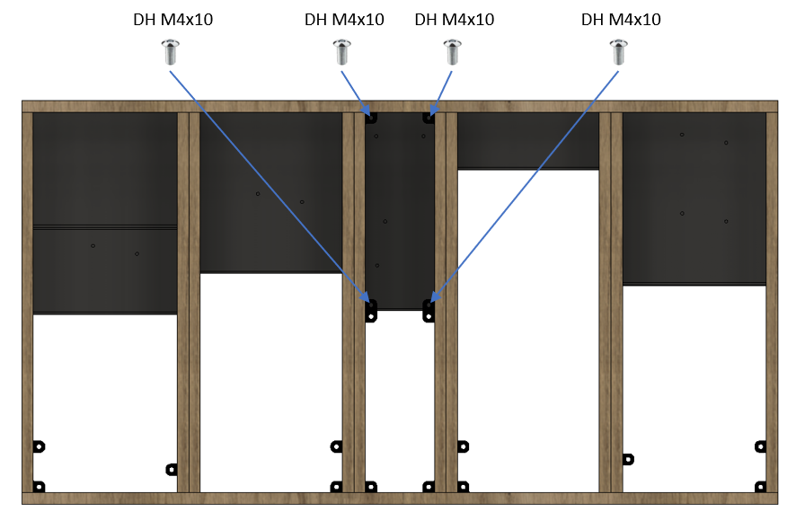

# 42. AFT Blank Panels

[📦 Download the printable model on MakerWorld](https://makerworld.com/en/models/3423496-boeing-737-overhead-aft-blank-panels)

[← Back to model list](README.md)

---

## Photos

<table>
<tbody>
<tr>
<td align="center" width="50%"> The six blank panels</td>
<td align="center" width="50%"> The blank panels from behind, with the five MEGA 2560 boards</td>
</tr>
</tbody>
</table>

---

## Panel Positions

---

## Filament

| | Colour | Filament |
|---|---|---|
|  | Dark Gray | C-Tech Premium Line PLA RAL7011 |

---

## 3D Printed Parts

| Qty | Part | Notes |
|---:|---|---|
| 1× | Blank AFT panel 1 | print on a **Textured** PEI plate |
| 1× | Blank AFT panel 2 | print on a **Textured** PEI plate |
| 1× | Blank AFT panel 3 | print on a **Textured** PEI plate |
| 1× | Blank AFT panel 4 | print on a **Textured** PEI plate |
| 1× | Blank AFT panel 5 | print on a **Textured** PEI plate |
| 1× | Blank AFT panel 6 | print on a **Textured** PEI plate |
| 22× | M4 washer | one under each M4×16 screw |

---

## Electronic Components

| Qty | Part | Reference |
|---:|---|---|
| 5× | **MEGA 2560 PRO MINI** | [The boards](../system-overview.md#the-boards) |
| 2× | **Splice connector F15** - lever type, 1 in / 5 out | [Product I used](../../images/parts/AE_splice_F15.png) |

Four of the panels carry the boards marked in [The boards](../system-overview.md#the-boards), each with its RJ45 Hub Shield plugged on top:

| Panel | Board | MobiFlight |
|---|---|---|
| Blank AFT panel 1 | mega 1a, mega 1b | `Overhead_1a`, `Overhead_1b` |
| Blank AFT panel 3 | mega 3 | `Overhead_3` |
| Blank AFT panel 4 | mega 4 | `Overhead_4` |
| Blank AFT panel 6 | mega 5 | `Overhead_5` |

The two splice connectors are screwed to the back of panel 3 and distribute the **5 V**: one carries **+5 V**, the other **GND**.

---

## Screws

| Qty | Screw | Joins |
|---:|---|---|
| 22× | Flat head M4×16 | panels 1, 2, 4, 5 and 6 + main frame |
| 10× | Dome head M3×5 | MEGA 2560 + panels 1, 3, 4 and 6 |
| 2× | Dome head M3×14 | panel 3 + splice connectors |
| 4× | Dome head M4×10 | panel 3 + main frame |

---

## PCB

| Qty | PCB | Connections used | Gerber files |
|---:|---|---|---|
| 5× | [RJ45 Hub Shield](../pcb/rj45-hub-shield.md) | mega 1a: D0-D6 and A2 mega 1b: D0-D3, D6, A1 and A2 mega 3, mega 4, mega 5: all nine sockets | [📥 PCB_RJ45_Hub_Shield.zip](https://raw.githubusercontent.com/om7ea/B737/main/PCB/PCB_RJ45_Hub_Shield.zip) |

Which panel each socket goes to is in the [Socket map](../system-overview.md#socket-map). The shields are fitted in [step 1](#1-mega-2560-boards-rj45-hub-shields-and-splice-connectors) of the assembly diagram.

---

## Assembly Diagram

Screw abbreviations used in the diagrams: **FH** = flat head, **DH** = dome head.

### 1. MEGA 2560 boards, RJ45 Hub Shields and splice connectors

### 2. Panels 1, 2, 4, 5 and 6 onto the main frame

### 3. Panel 3 onto the main frame

