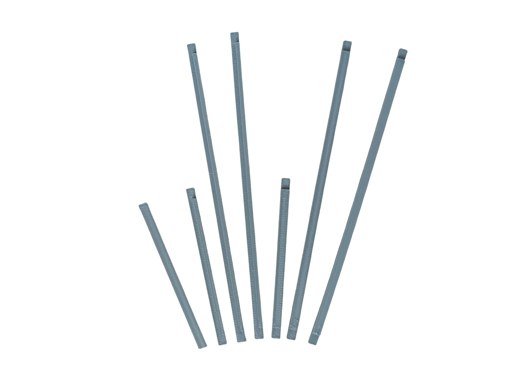
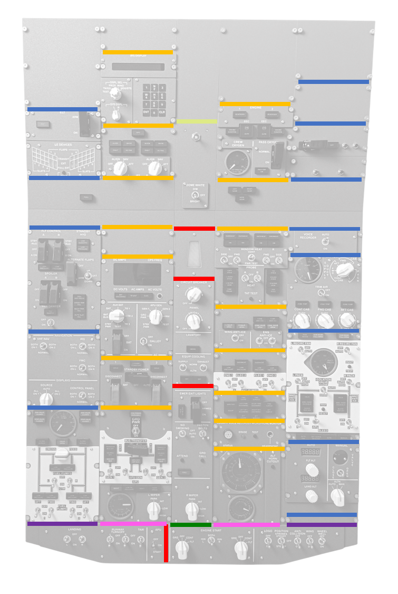

# 43. Backlight Blocking Strips

[← Back to model list](README.md)

---

> **Note**
> The strips go into the gaps between neighbouring panels and stop the backlight from shining through those gaps to the front of the overhead.

---

## Photos

<table>
<tbody>
<tr>
<td align="center" width="50%"> The seven types of strip</td>
</tr>
</tbody>
</table>

---

## Strip Positions

Each colour on the drawing is one type of strip - see the **On the diagram** column below.

---

## Filament

| | Colour | Filament |
|---|---|---|
|  | Dark Gray | C-Tech Premium Line PLA RAL7011 |

---

## 3D Printed Parts

| Qty | Part | On the diagram |
|---:|---|---|
| 13× | 145mm | blue |
| 15× | 143mm | yellow |
| 2× | 143mm-half | pink |
| 2× | 145mm-half | purple |
| 4× | 80mm | red |
| 1× | 80mm-half | dark green |
| 1× | 80mm-flat | light green |

---

## Assembly

Each strip is put between two panels while the panels are being screwed to the main frame. The strips need no screws of their own.
