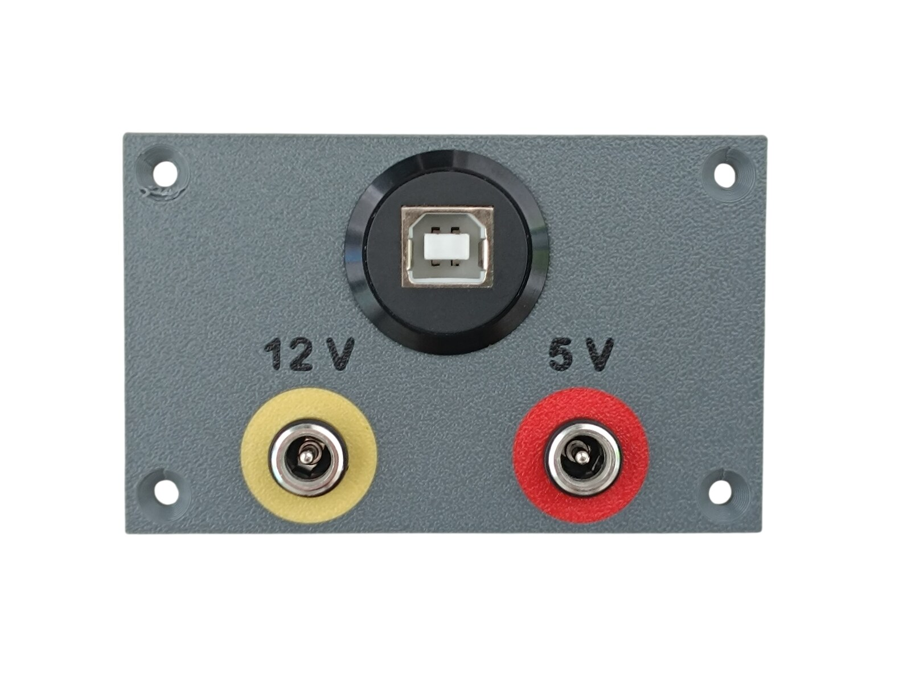
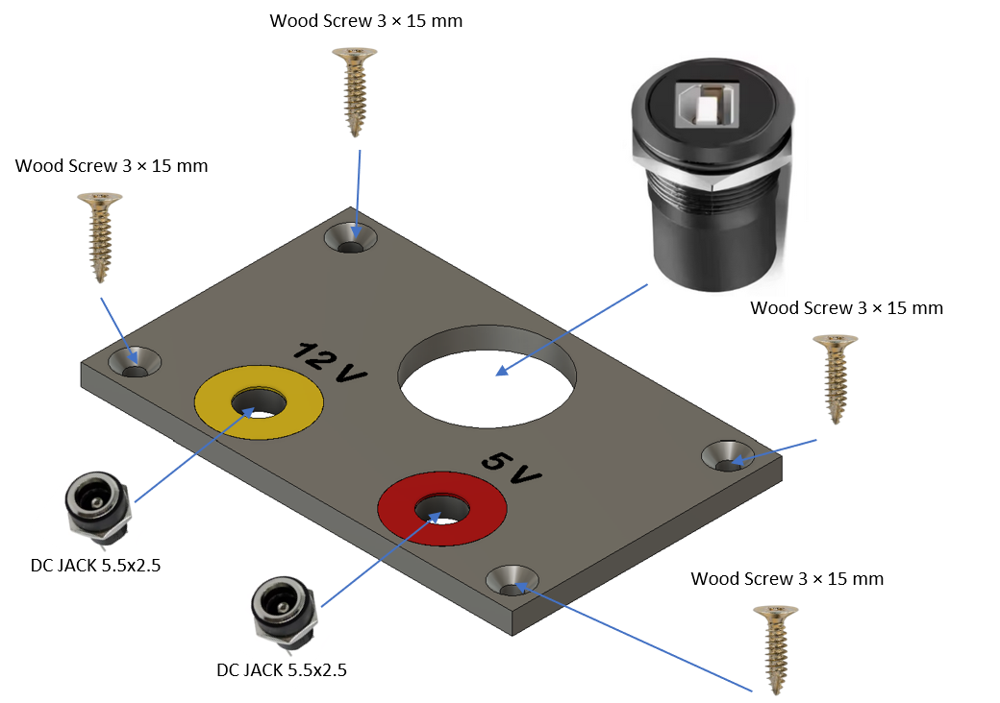

# 44. Rear Power and USB Panel

[📦 Download the printable model on MakerWorld](https://makerworld.com/en/models/3437216-boeing-737-overhead-rear-power-and-usb-panel)

[← Back to model list](README.md)

---

The two power supplies and the USB cable to the PC plug into this panel on the back of the overhead - see [Power supply](../system-overview.md#power-supply).

---

## Photos

<table>
<tbody>
<tr>
<td align="center" width="50%"> The finished panel - Dark Gray, the lettering in Black, the rings in Yellow (12 V) and Red (5 V)</td>
</tr>
</tbody>
</table>

---

## Filament

| | Colour | Filament |
|---|---|---|
|  | Dark Gray | C-Tech Premium Line PLA RAL7011 |
|  | Black | Bambu PLA Basic Black (10101) |
|  | Yellow | Bambu PLA Basic Yellow (10400) |
|  | Red | Bambu PLA Basic Red (10200) |

---

## 3D Printed Parts

| Qty | Part | Notes |
|---:|---|---|
| 1× | Rear panel | print on a **Textured** PEI plate |

---

## Electronic Components

| Qty | Part | Reference |
|---:|---|---|
| 2× | DC jack 5.5 × 2.5 mm | [Product I used](../../images/parts/AE_dc_jack.png) |
| 1× | USB-B to USB-A panel mount adapter, thread Ø 22 mm | [Product I used](../../images/parts/AE_usb_panel_mount.png) |

---

## Screws

| Qty | Screw | Joins |
|---:|---|---|
| 4× | Wood screw 3 × 15 mm | rear panel + wooden frame |

---

## Assembly Diagram

### 1. DC jacks, USB adapter and mounting

> **Note**
> This panel is fitted last of all. Plug the USB cable into the adapter from the inside first, then look for a suitable position for the panel, and screw it to the wooden frame there.
