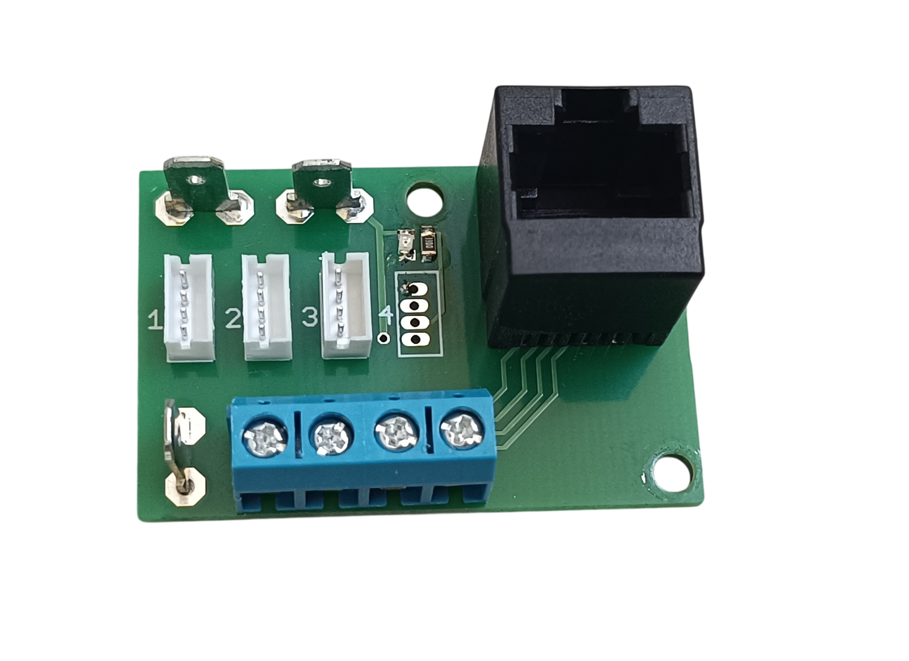
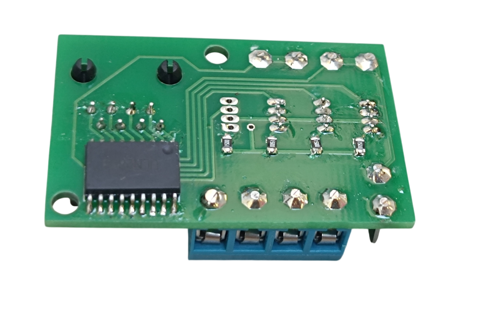
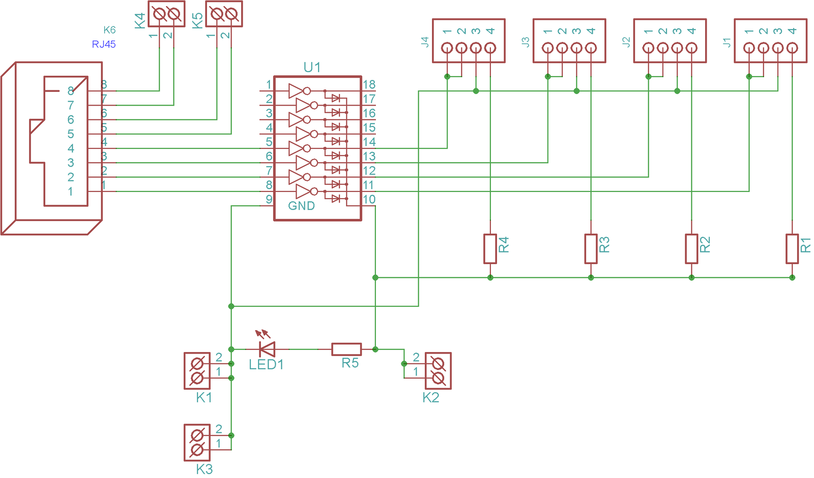
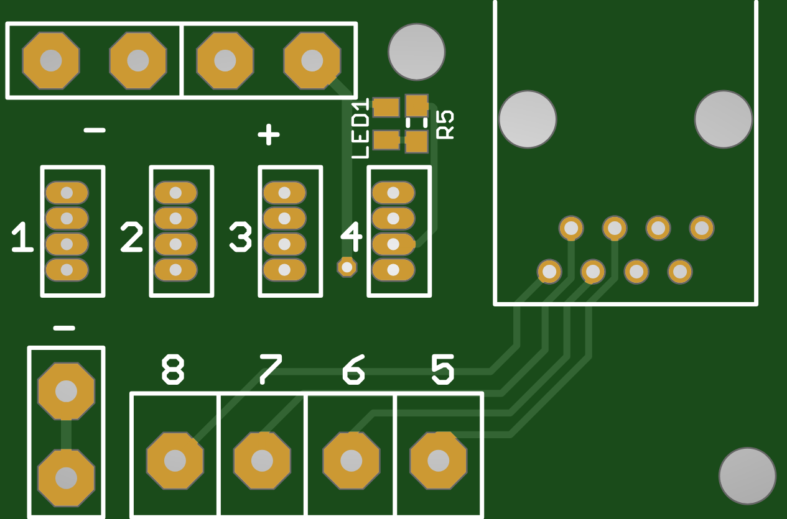
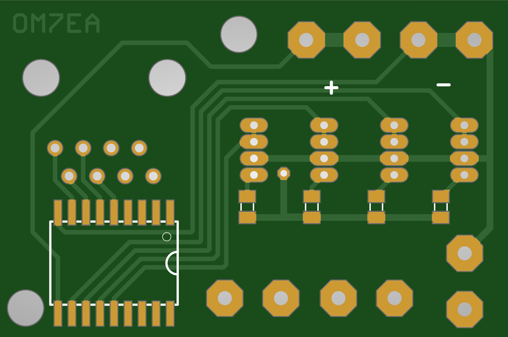

# 4. RJ45 Combined

**4 pins with LED driver + 4 pins direct**

[📥 Download Gerber files - PCB_RJ45_Combined.zip](https://raw.githubusercontent.com/om7ea/B737/main/PCB/PCB_RJ45_Combined.zip)

[← Back to PCB overview](README.md)

---

## Purpose

Designed to connect up to **4 annunciators and 4 direct connections**. This PCB combines the functionality of the [RJ45 Direct](rj45-direct.md) and [RJ45 LED Driver](rj45-driver.md) boards.

## Quantity

A total of **6** PCBs are required for the complete project. I recommend ordering a few extra in case some are damaged during assembly.

---

## Bill of Materials (BOM) - per PCB

| Qty per PCB | Total for 6 PCBs | Part | Schematic | Reference |
|---:|---:|---|---|---|
| 1× | 6× | **RJ45 connector** - 5224 8P8C in-line, vertical 180°, full plastic | K6 | [Product I used](../../images/parts/AE_RJ45.png) |
| 3× | 17× | **4.8 mm PCB male Faston terminal** | K1-K3 | [Product I used](../../images/parts/AE_plug_male.png) |
| 1-4× | - | **Header ZH 1.5 4P** - part of the [ZH set](annunciator.md) | J1-J4 | |
| as required | 13× | **150 Ω resistor (0805)** - for yellow LED | R1-R4 | |
| as required | 3× | **250 Ω resistor (0805)** - for white LED | R1-R4 | |
| 1× | 6× | **ULN2803** | U1 | [Product I used](../../images/parts/AE_ULN2803.png) |
| as required | 2× | **KF301 PCB screw terminal** - 2P blue | K4, K5 | [Product I used](../../images/parts/AE_KF301_2p.png) |
| as required | 4× | **KF301 PCB screw terminal** - 4P blue | K4, K5 | [Product I used](../../images/parts/AE_KF301_4p.png) |
| as required | 1× | **KF301 PCB screw terminal** - 2P black | K4, K5 | |
| 1× | 6× | **330 Ω resistor (0805)** - optional | R5 | |
| 1× | 6× | **Yellow-green LED (0805)** - optional | LED1 | [Product I used](../../images/parts/AE_led_0805.png) |

---

## Schematic

## PCB Layout

<table>
<tbody>
<tr>
<td align="center"> Top</td>
<td align="center"> Bottom</td>
</tr>
</tbody>
</table>
