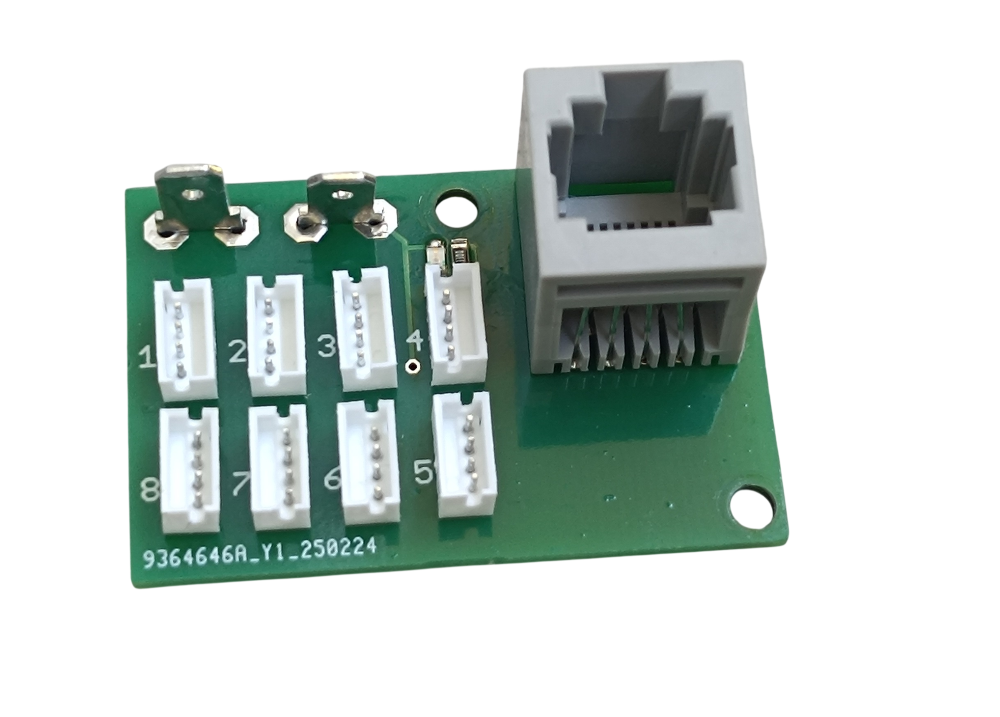
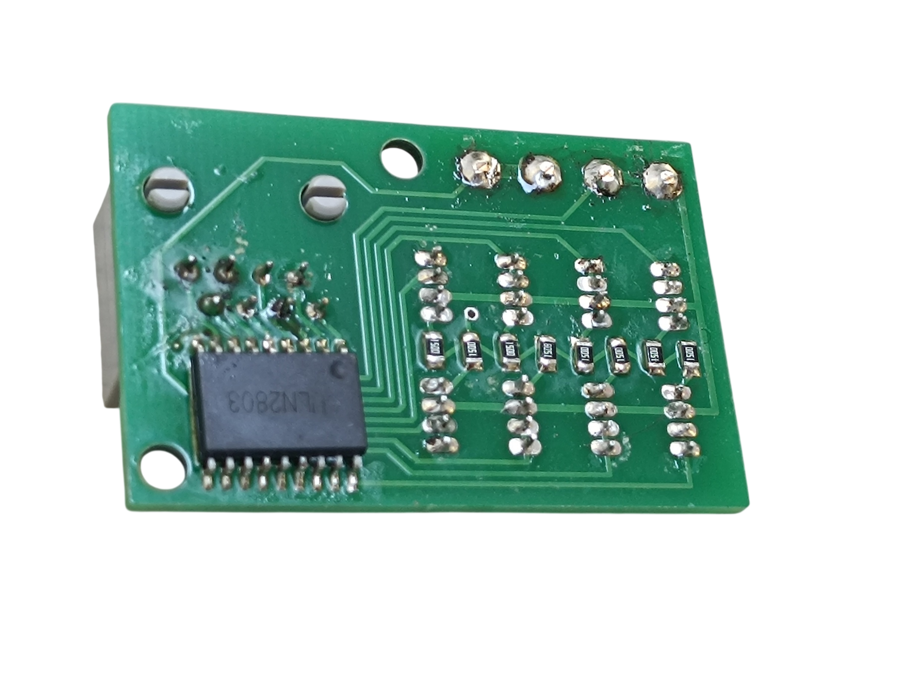
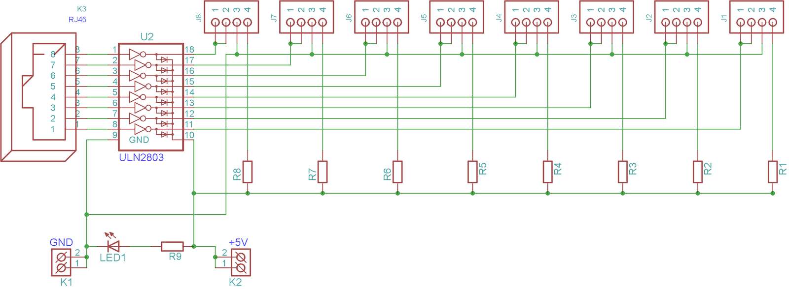
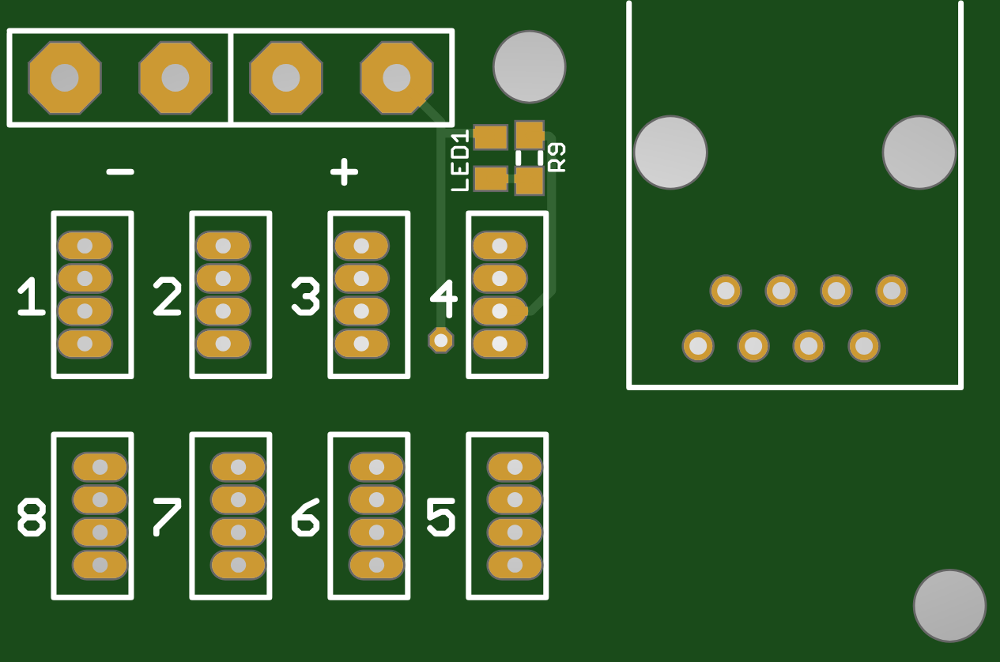
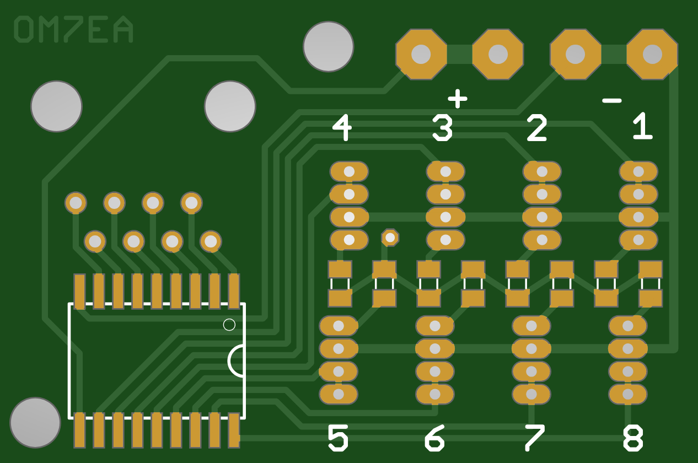

# 3. RJ45 LED Driver

[📥 Download Gerber files - PCB_RJ45_Driver.zip](https://raw.githubusercontent.com/om7ea/B737/main/PCB/PCB_RJ45_Driver.zip)

[← Back to PCB overview](README.md)

---

## Purpose

Designed to connect up to **8 annunciators** with push buttons. The integrated driver powers the LEDs, reducing the current load on the board when connecting a large number of LEDs.

## Quantity

A total of **20** PCBs are required for the complete project. I recommend ordering a few extra in case some are damaged during assembly.

---

## Bill of Materials (BOM) - per PCB

| Qty per PCB | Total for 20 PCBs | Part | Schematic | Reference |
|---:|---:|---|---|---|
| 1× | 20× | **RJ45 connector** - 5224 8P8C in-line, vertical 180°, full plastic | K3 | [Product I used](../../images/parts/AE_RJ45.png) |
| 2× | 40× | **4.8 mm PCB male Faston terminal** | K1, K2 | [Product I used](../../images/parts/AE_plug_male.png) |
| 2× | 40× | **6.3 mm female Faston with sheath** - crimped on the wire | K1, K2 | [Product I used](../../images/parts/AE_faston_female.png) |
| 1-8× | - | **Header ZH 1.5 4P** - part of the [ZH set](annunciator.md) | J1-J8 | |
| 1-8× | 108× | **SMD 0805 resistors** - see the table below for values | R1-R8 | |
| 1× | 20× | **ULN2803** | U2 | [Product I used](../../images/parts/AE_ULN2803.png) |
| 1× | 20× | **330 Ω resistor (0805)** - optional | R9 | |
| 1× | 20× | **Yellow-green LED (0805)** - optional | LED1 | [Product I used](../../images/parts/AE_led_0805.png) |

The number of headers and resistors depends on the panel - the PCB section of each panel's page lists which headers are populated.

### Resistor Values

| LED | Value | Total for 20 PCBs |
|---|---|---:|
| yellow LED | 150 Ω | 81× |
| green LED | 330 Ω | 9× |
| white LED - no dual brightness annunciator | 250 Ω | 9× |
| white LED - dual brightness annunciator, main cable | 100 Ω | 9× |
| dual brightness annunciator, second cable (two wires) | no resistor | - |

Each resistor belongs to the header with the same number - R1 to J1, R2 to J2 and so on - so choose its value by the annunciator plugged into that header.

---

## Schematic

## PCB Layout

<table>
<tbody>
<tr>
<td align="center"> Top</td>
<td align="center"> Bottom</td>
</tr>
</tbody>
</table>
